# bounzy

**Bounce into any server.** – Selbst gehostetes Web-Gateway für RDP, VNC und SSH. Zugriff per Browser,
ohne Client, ohne offene Ports beim Kunden. Protokoll-Engine ist [Apache Guacamole `guacd`](https://guacamole.apache.org/);
Oberfläche, API, Tunnel, Tresor, Rechte und Audit sind eigene Komponenten.

> Status: **MVP (Phase 1) – Schritte a–f umgesetzt**. Anmeldung (authentik/OIDC – in der Oberfläche einstellbar, Passkeys, lokale Konten und Notfall-Admin mit TOTP),
> Verbindungsverwaltung, verschlüsselter Tresor, Remote-Sitzungen über RDP, VNC und SSH (Direktlink
> `/c/<id>`), Übersicht mit Strg+K-Suche, Sitzungs-Tabs (Kacheln, parallele Eingabe in SSH/Telnet) und -Menü, Branding & CI je Instanz und Mandant,
> Rollen (Admin, Techniker, Nur lesen) auf Mandant/Gruppe/Verbindung über authentik-Gruppen sowie Audit-Log
> mit CSV-Export; Installation per Docker Compose oder als Proxmox-LXC. Phase 2: Sitzungsaufzeichnung
> (verschlüsselt, Wiedergabe mit Zeitleiste, Volltextsuche in SSH-Sitzungen, Frist je Mandant) und
> Live-Sitzungen (Mitansehen, Beenden, Teilen per Link mit sichtbarem Zuschauer-Hinweis) sowie Standort-Gateways
> mit Registrierung per Token, Status/Version und optional ohne VPN (Agent verbindet sich ausgehend) und
> Wake-on-LAN über das Gateway im Zielnetz, Import aus Royal TS (Skript), mRemoteNG, Apache Guacamole, Remote Desktop Manager, .rdp-Dateien und beliebigen CSV-Dateien sowie
> Vier-Augen-Freigabe für kritische Verbindungen (zweiter Admin gibt für ein Zeitfenster frei),
> Zugangsdaten je Ordner mit Vererbung und Tasks/Schnipsel wie in Royal TS und
> Proxmox-VM-Konsolen (VM-Liste abgleichen, auswählen, verbinden – direkt oder über den Agenten am Standort),
> Telnet, Dateibrowser in der Sitzung und Web-Oberflächen von Geräten im abgeschotteten Remote-Browser,
> Hyper-V-Konsolen, Erreichbarkeit je Verbindung; Phase 3: REST-API mit API-Tokens, Webhooks, Warnung bei
> Anmeldungen außerhalb der Geschäftszeiten und Bedienung auf Telefon und Tablet.

> REST-API mit API-Tokens: [`docs/API.md`](docs/API.md). Produkt-Website: [bounzy.de](https://bounzy.de).

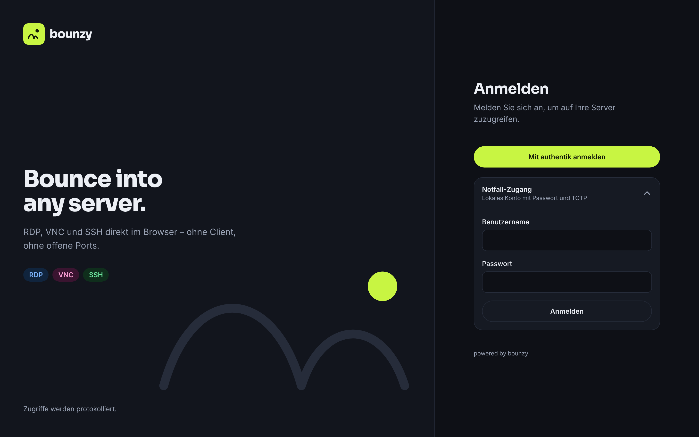

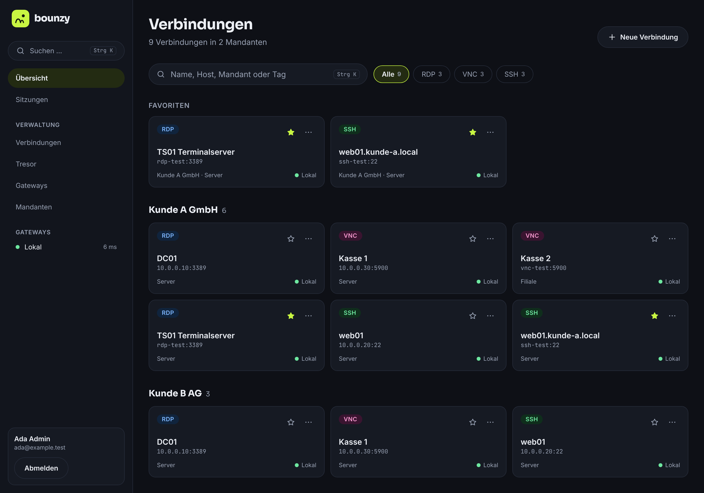

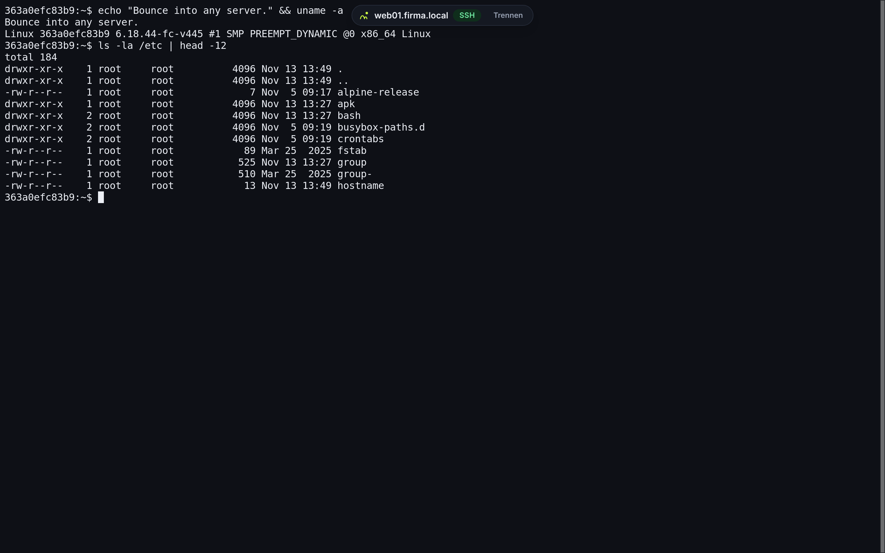

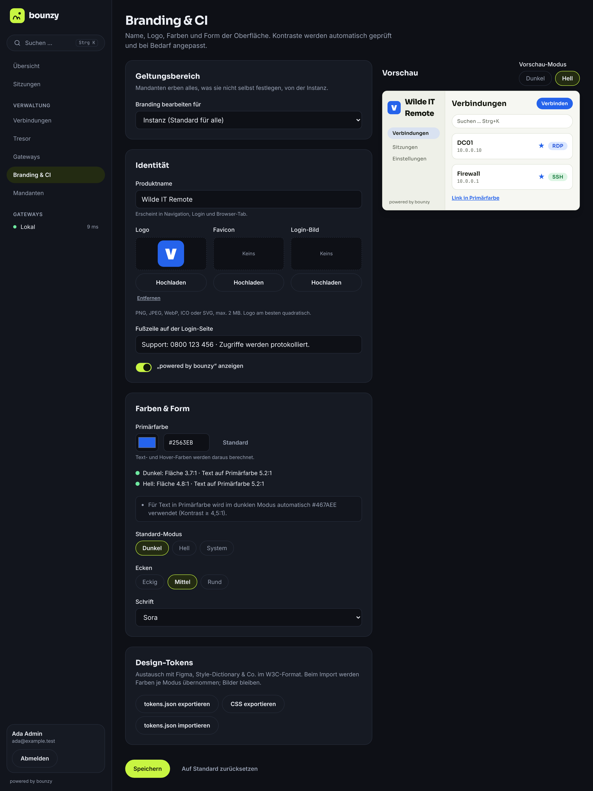

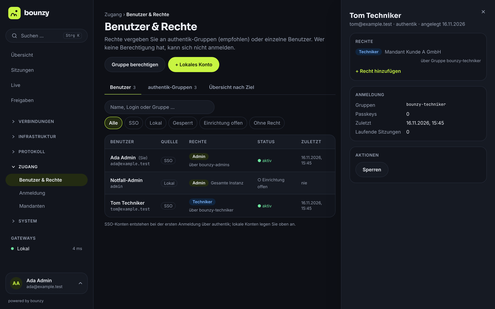

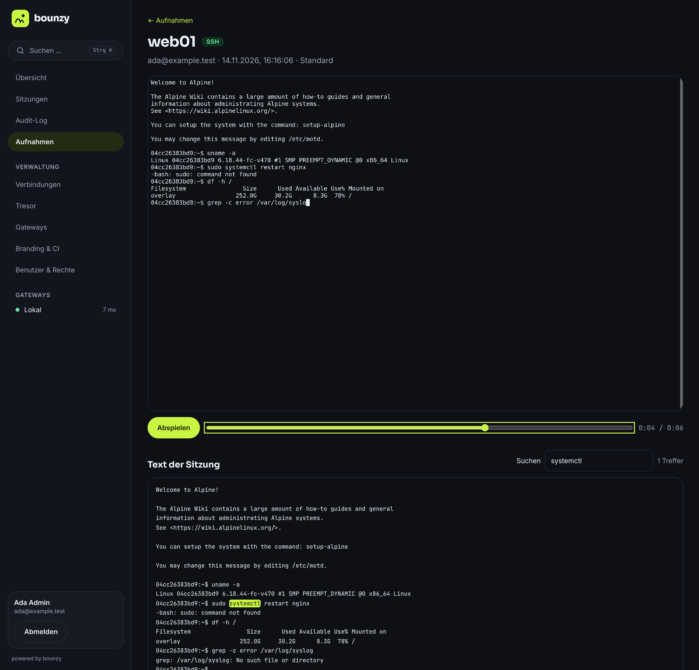

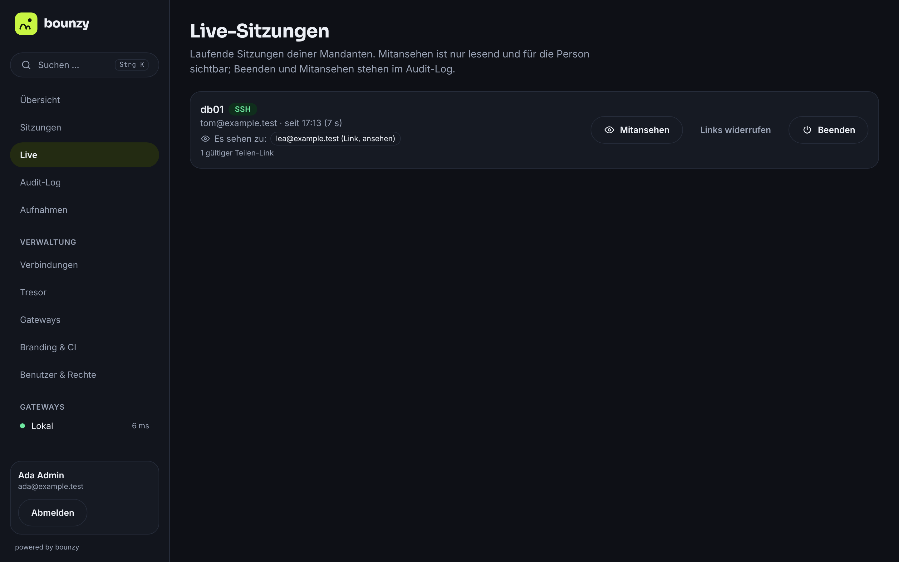

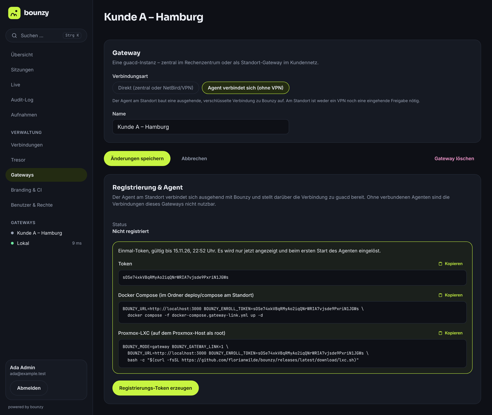

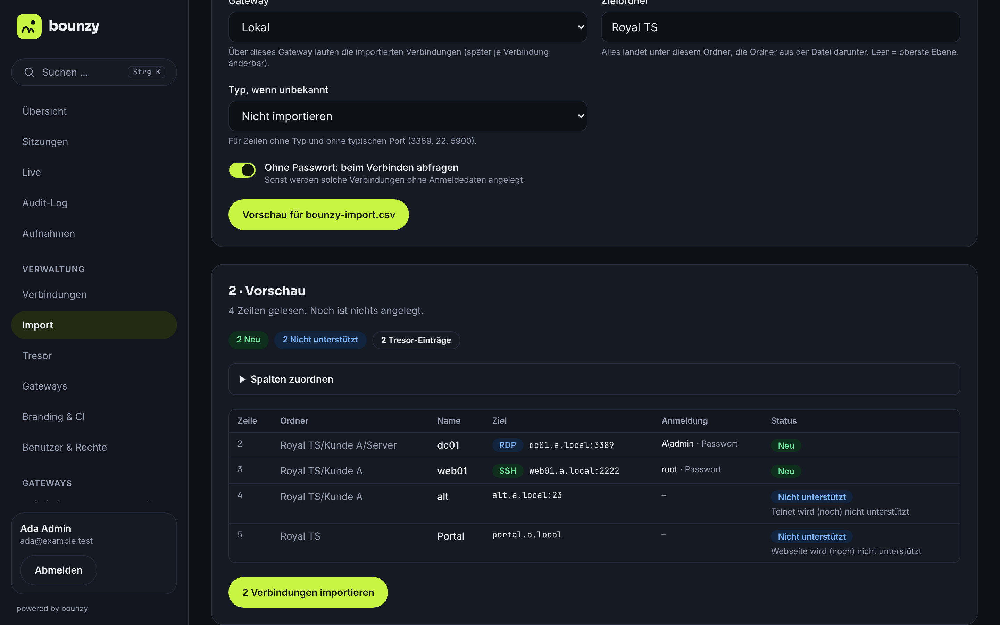

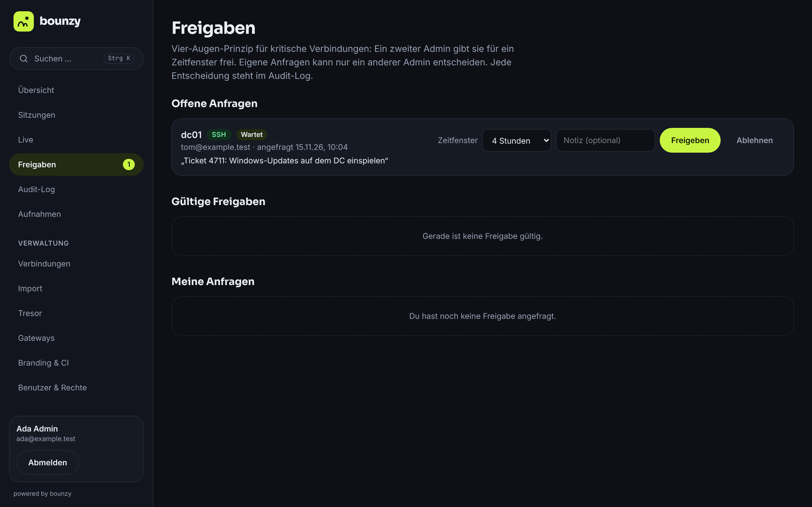

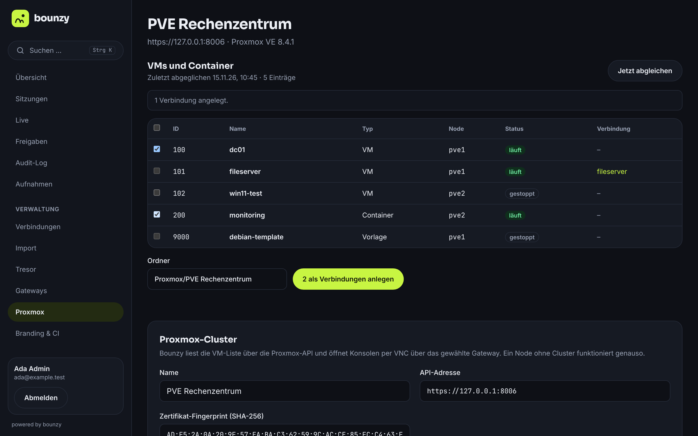

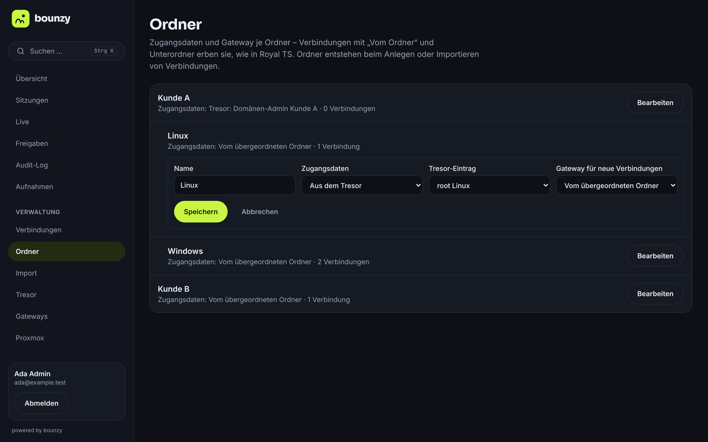

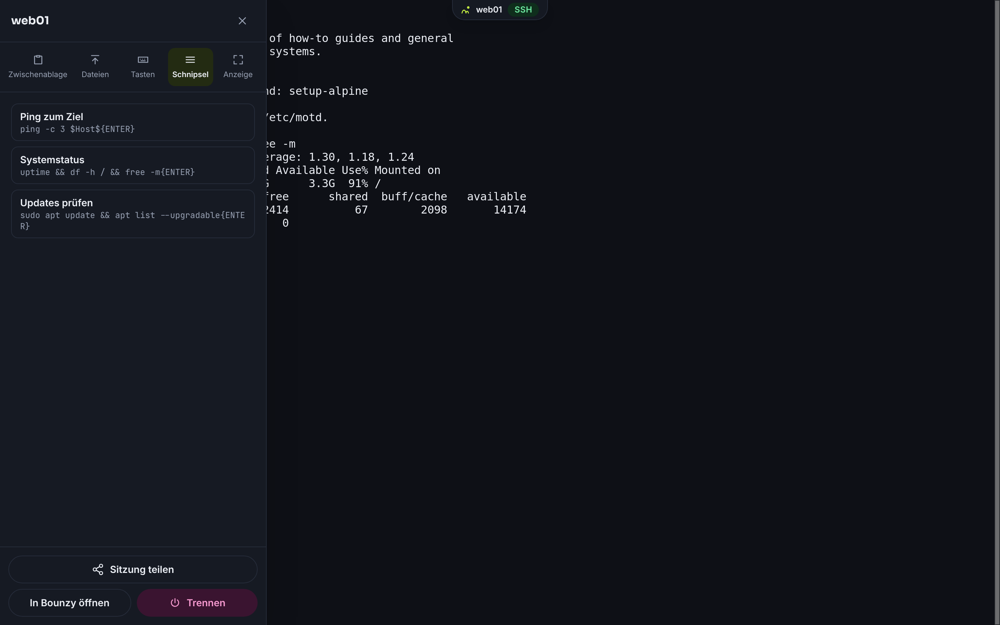

## Installation mit Docker Compose (≈ 10 Minuten)

Voraussetzungen: Linux-Host mit Docker ≥ 24 und Compose v2, ein Reverse Proxy mit TLS
(Nginx Proxy Manager, NetBird-Proxy, Traefik …), DNS-Eintrag z. B. `bounzy.example.de`.

```bash
curl -fsSL https://github.com/florianwilde/bounzy/releases/latest/download/bounzy-compose.tar.gz | tar xz
```

```bash
cd bounzy && ./init.sh
```

Das Paket enthält die Compose-Dateien (auch für Standort-Gateways), `init.sh` und eine `.env.example` mit der
Version des Releases.

`init.sh` erzeugt alle Geheimnisse unter `secrets/` (Datenbank-Passwörter, Master-Key, Initialpasswort des
Notfall-Admins) und legt `.env` an. In `.env` mindestens `BOUNZY_BASE_URL` setzen, dann starten:

```bash
docker compose up -d
```

Im Reverse Proxy die Domain auf `http://<host>:8080` zeigen lassen (WebSocket-Unterstützung aktivieren).
Standardmäßig lauscht Bounzy nur auf `127.0.0.1:8080`; läuft der Proxy auf einem anderen Host,
`BOUNZY_HTTP_BIND` anpassen und `BOUNZY_TRUSTED_PROXIES` auf dessen IP setzen.

Anmeldung: Benutzer `admin`, Passwort wie von `init.sh` ausgegeben (steht in `secrets/initial_admin_password`).
Beim ersten Login werden ein neues Passwort und TOTP verlangt.

> **Master-Key sichern!** `secrets/master_key` verschlüsselt alle gespeicherten Zugangsdaten. Ohne ihn sind sie
> nach einem Restore verloren. Getrennt vom Datenbank-Backup aufbewahren – siehe [`docs/BETRIEB.md`](docs/BETRIEB.md).

### Anmeldung über authentik (OIDC)

In authentik einen **OAuth2/OpenID-Provider** und eine Anwendung anlegen:

- Client-Typ *Confidential*, Redirect-URI `https://bounzy.example.de/auth/callback`
  (für jede Mandanten-Domain eine weitere Redirect-URI)
- Scopes `openid`, `profile`, `email` und ein Scope-Mapping, das die Gruppen als Claim `groups` liefert
  (`return [group.name for group in request.user.ak_groups.all()]`)

Dann in `.env` `BOUNZY_OIDC_ISSUER` (z. B. `https://auth.example.de/application/o/bounzy/`) und
`BOUNZY_OIDC_CLIENT_ID` setzen, das Client-Secret nach `secrets/oidc_client_secret` schreiben und mit
`BOUNZY_OIDC_ADMIN_GROUP` die authentik-Gruppe festlegen, die Admin-Rechte bekommt. Benutzer ohne
zugeordnete Gruppe können sich nicht anmelden.

Weitere Rollen (Techniker, Nur lesen) vergeben Sie danach in Bounzy unter *Benutzer & Rechte* an
authentik-Gruppen – siehe [`docs/BETRIEB.md`](docs/BETRIEB.md#benutzer-rollen-und-rechte).

### Standort-Gateway (guacd beim Kunden)

Zwei Varianten, beide mit Registrierung per Einmal-Token (in Bounzy unter *Gateways › Neues Gateway*, danach
*Registrierungs-Token erzeugen* – Bounzy zeigt die fertigen Befehle an):

- **Agent verbindet sich (ohne VPN):** Der Agent am Standort baut eine ausgehende, verschlüsselte Verbindung
  zu Bounzy auf. Keine eingehende Freigabe, kein NetBird.

  ```bash
  BOUNZY_URL=https://bounzy.example.de BOUNZY_ENROLL_TOKEN=<Token> docker compose -f docker-compose.gateway-link.yml up -d
  ```

- **Direkt über NetBird/WireGuard:** Bounzy verbindet sich zu guacd (TLS, Zertifikat gepinnt). Mit Agent
  übernimmt Bounzy das Zertifikat bei der Registrierung und zeigt Status und Version.

  ```bash
  ./gateway-init.sh
  ```

  ```bash
  BOUNZY_URL=https://bounzy.example.de BOUNZY_ENROLL_TOKEN=<Token> BOUNZY_GATEWAY_BIND=100.64.0.12 docker compose -f docker-compose.gateway.yml --profile agent up -d
  ```

Das Image `bounzy-gateway` enthält guacd mit TLS (eigener Build – das offizielle `guacamole/guacd` ist ohne
TLS gebaut), `bounzy-agent` den Agenten. Details: [`docs/BETRIEB.md`](docs/BETRIEB.md#standort-gateways).

## Installation als Proxmox-LXC (≈ 5 Minuten)

Auf dem Proxmox-VE-Host (ab Version 8) als root:

```bash
bash -c "$(curl -fsSL https://github.com/florianwilde/bounzy/releases/latest/download/lxc.sh)"
```

Das Skript fragt Container-ID, Speicher, Netzwerk und Ressourcen per Dialog ab (oder liest sie aus
Umgebungsvariablen, siehe Kopf von `lxc.sh`), legt einen **unprivilegierten
Debian-13-Container** an und installiert darin guacd, PostgreSQL, Caddy und Bounzy nativ als systemd-Dienste –
ohne Docker. Am Ende stehen interne Adresse und Initialpasswort des Notfall-Admins im Terminal.
Ohne Rückfragen, z. B. mit fester IP:

```bash
BOUNZY_NONINTERACTIVE=1 IP=10.0.0.20/24 GW=10.0.0.1 BOUNZY_BASE_URL=https://bounzy.example.de bash -c "$(curl -fsSL https://github.com/florianwilde/bounzy/releases/latest/download/lxc.sh)"
```

Standort-Gateway (nur guacd, im Kundennetz): `BOUNZY_MODE=gateway` voranstellen – mit Agent zusätzlich
`BOUNZY_URL=… BOUNZY_ENROLL_TOKEN=…`, ohne VPN außerdem `BOUNZY_GATEWAY_LINK=1`. Das Skript liegt an jedem
[GitHub-Release](https://github.com/florianwilde/bounzy/releases) (dort auch `SHA256SUMS`); `latest` ist immer die
neueste Version, eine feste Version z. B. `…/releases/download/v0.3.0/lxc.sh`.
Betrieb, Update und Backup: [`docs/BETRIEB.md`](docs/BETRIEB.md#proxmox-lxc).

## Betriebsarten

- **Einzelmandant** (`BOUNZY_TENANCY_MODE=single`, Standard): eine Firma, Mandanten-Verwaltung ausgeblendet.
- **Mehrmandanten** (`multi`): MSP-Betrieb mit Kunden als Mandanten, Branding und Domain je Mandant
  (Einrichtung einer Mandanten-Domain: [`docs/BETRIEB.md`](docs/BETRIEB.md#branding-und-mandanten-domains)).

Die Betriebsart ist später in den Einstellungen umschaltbar (multi → single nur bei genau einem Mandanten).

## Lizenz

Proprietär, siehe [`LICENSE`](LICENSE). Drittkomponenten (u. a. Apache Guacamole, Apache-2.0): [`NOTICE`](NOTICE).
