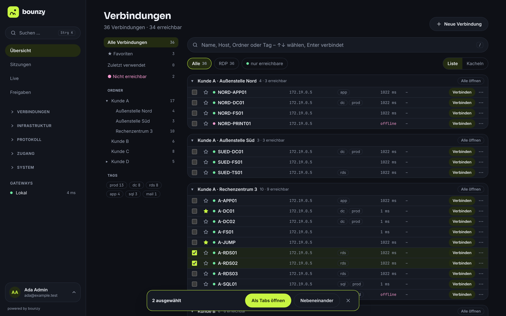

# Bounzy – Betrieb

Stand: MVP (Schritte a–f, LXC-Installer). Abschnitte werden mit jedem Schritt ergänzt.

## Komponenten und Daten

| Was | Compose | Inhalt | Sicherung |
|---|---|---|---|
| Datenbank | Volume `pgdata` | Benutzer, Verbindungen, verschlüsselte Zugangsdaten, Audit-Log | `pg_dump` (s. u.) |
| Master-Key | `secrets/master_key` | Schlüssel für den Tresor (KEK) | **separat**, offline/Passwortmanager |
| DB-Zugänge | `secrets/db_*`, `secrets/database_url_*` | Passwörter der Rollen `bounzy_owner`/`bounzy_app` | mit Master-Key |
| Assets | Volume `assets` (`BOUNZY_ASSET_DIR`) | Logos, Favicons, Login-Bilder (Branding) | Dateisicherung, zusammen mit der DB |
| Laufwerke | Volume `drives` | RDP-Laufwerksumleitung je Benutzer | optional |
| Aufnahmen | Volume `recordings` (`BOUNZY_RECORDING_DIR`) | Sitzungsaufnahmen und SSH-Mitschnitte, verschlüsselt | mit DB **und** Master-Key (Schlüssel liegen in der DB) |

## Datenbank-Rollen

- `bounzy_owner` – Eigentümer aller Tabellen, nur für Migrationen (`migrate`-Container).
- `bounzy_app` – Laufzeit (web, tunnel). Darf das Audit-Log **nur lesen und anhängen**.
- Zusätzlich verhindert ein Trigger jedes `UPDATE`/`DELETE`/`TRUNCATE` auf `AuditEvent`, und jeder Eintrag
  ist per SHA-256-Hash mit seinem Vorgänger verkettet. Prüfen:

```bash
docker compose run --rm migrate node --import tsx src/main.ts audit verify
```

## Backup

```bash
docker compose exec -T postgres pg_dump -U bounzy_owner -Fc bounzy > bounzy-$(date +%F).dump
```

Master-Key und `secrets/` getrennt davon sichern. Ein Datenbank-Dump ohne Master-Key enthält die Zugangsdaten
nur verschlüsselt – das ist gewollt (Diebstahl eines Backups gibt keine Passwörter preis).

Restore (leere Instanz, gleiche `secrets/`):

```bash
docker compose up -d postgres
```

```bash
docker compose exec -T postgres pg_restore -U bounzy_owner -d bounzy --clean --if-exists < bounzy-2026-01-01.dump
```

```bash
docker compose up -d
```

Vor dem Start prüfen, ob der Master-Key zur Sicherung passt (sonst sind gespeicherte Zugangsdaten unlesbar):

```bash
docker compose run --rm migrate node --import tsx src/main.ts key verify
```

Aufzeichnungen liegen im Volume `recordings` (verschlüsselt) – mit sichern, z. B. per Volume-Backup.

### Proxmox-LXC

Zwei Wege, am besten beide:

- **Proxmox Backup Server (PBS):** Snapshot des ganzen Containers (inkl. Master-Key). Wiederherstellen
  in Proxmox – fertig.
- **`bounzy backup --full`:** Datenbank, Aufzeichnungen und Konfiguration in eine Datei unter
  `/var/backups/bounzy/bounzy-full-<Zeit>.tar.gz` (nur root lesbar, die letzten 3 bleiben). Der Master-Key
  ist absichtlich **nicht** enthalten – `/etc/bounzy/secrets/master_key` einmal getrennt aufbewahren
  (Passwortmanager). `--with-key` nimmt ihn mit; dann die Datei wie den Schlüssel selbst schützen.
  `bounzy backup` ohne Option sichert nur die Datenbank (die letzten 14 bleiben); Updates legen zusätzlich
  vor jeder Migration einen Dump an (`…-vor-<Version>.dump`).

Täglich automatisch (Beispiel, im Container):

```bash
echo '15 2 * * * root /usr/local/bin/bounzy backup --full >/dev/null' > /etc/cron.d/bounzy-backup
```

Die Dateien dann vom Container wegkopieren (z. B. per PBS, `rsync` oder Netzlaufwerk) – ein Backup auf
derselben Platte hilft nicht beim Plattenausfall.

**Wiederherstellen** (gleiche oder neu installierte Instanz, gleiche oder neuere Bounzy-Version):

```bash
bounzy restore /var/backups/bounzy/bounzy-full-20261119-021500.tar.gz --key /root/master_key
```

`--key` weglassen, wenn es dieselbe Instanz ist (bzw. die Sicherung mit `--with-key` erstellt wurde). Ablauf:

1. Sicherung lesen und in eine Wegwerf-Datenbank einspielen; prüfen, ob der Master-Key alle Datenschlüssel
   öffnet – passt er nicht, bricht `restore` ab, **ohne etwas zu verändern**.
2. Rückfrage (mit `--yes` ohne), dann Dump des aktuellen Stands (`…-vor-restore.dump`).
3. web und tunnel anhalten, Datenbank ersetzen, Master-Key übernehmen (der bisherige bleibt als
   `master_key.vor-restore-<Zeit>`), Aufzeichnungen zurückspielen.
4. Migrationen auf die installierte Version, `key verify`, Start, Prüfung der Audit-Kette.

Die Konfiguration der Sicherung wird nicht automatisch übernommen, sondern als
`/etc/bounzy/bounzy.env.aus-sicherung` abgelegt (z. B. App-URL vergleichen und mit `bounzy address` setzen).
Neue Instanz für eine Wiederherstellung: wie gewohnt mit `lxc.sh` installieren, dann `bounzy restore`.
Standort-Gateways haben keine Datenbank – dort reicht PBS bzw. eine Neuinstallation.

Der Ablauf ist im LXC-Smoke-Test der CI abgedeckt (Vollsicherung, falscher Schlüssel, Wiederherstellung
mit Rechten und Aufzeichnungen).

## Update

```bash
docker compose pull && docker compose up -d
```

Der `migrate`-Container spielt neue Migrationen vor dem Start von web/tunnel ein. Vorher ein Backup ziehen.
**Verwaltung › Update** zeigt die installierte und die neueste Version; aktualisiert wird bei Compose
bewusst auf dem Docker-Host (die Weboberfläche hat keinen Zugriff auf Docker). Proxmox-LXC: Update auch
direkt aus der Weboberfläche, siehe unten.
Versionen werden über `BOUNZY_VERSION` in `.env` gepinnt (empfohlen statt `latest`).

**Nach Updates suchen** fragt GitHub sofort ab (sonst stündlich) und listet die Änderungen aller neueren
Versionen. Scheitert die Abfrage, steht der Grund daneben (DNS, keine Verbindung, Zeitüberschreitung,
TLS-Fehler durch einen Proxy, Abruflimit von GitHub) und im Protokoll von bounzy-web. Die Weboberfläche
braucht dafür ausgehend HTTPS zu `api.github.com`; `BOUNZY_UPDATE_CHECK=0` schaltet die Abfrage ab.

**Update-Quelle** (gleiche Seite, nur Admins der gesamten Instanz): das GitHub-Repo, aus dessen Releases
Bounzy Versionen anzeigt und installiert, Standard `florianwilde/bounzy`. Erlaubt ist nur `besitzer/repo`
(eine volle GitHub-URL wird gekürzt); das Repo muss öffentlich sein und Releases mit denselben Dateien
(`bounzy-linux-x64.tar.gz` und `SHA256SUMS`) haben. Die Änderung steht im Audit-Log („Update-Quelle
geändert“). LXC: Der Wert wird beim nächsten Update von root geprüft und nach `/etc/bounzy/update-repo`
übernommen und gilt dann auch für `bounzy update` in der Konsole. Ein Spiegel per
`BOUNZY_RELEASE_BASE` in `/etc/bounzy/update.env` hat weiterhin Vorrang.

## Gastlinks

Zugang zu genau **einer** Verbindung für Personen ohne Konto, z. B. externe Dienstleister.

- **Erlauben**: Zugang › Gastlinks (Admins der Instanz), je Mandant; standardmäßig aus. Ausschalten widerruft
  sofort alle offenen Links des Mandanten.
- **Erstellen**: Übersicht › ⋯ einer Verbindung › „Gastlink erstellen …“ (Admins des Mandanten): Zweck,
  Gültigkeit (1 h bis 7 Tage), Nutzungen (einmal, 5×, beliebig), optional PIN (4–8 Ziffern), „nur ansehen“
  (Standard) oder mit Bedienung. Der Link erscheint genau einmal – PIN getrennt weitergeben. Für kritische
  Verbindungen (Vier-Augen-Freigabe) gibt es keine Gastlinks.
- **Gast**: öffnet `/g/…`, gibt ggf. die PIN ein und landet direkt in der Sitzung. Die Gast-Anmeldung gilt
  nur für diese Seite – Übersicht, Verwaltung und API bleiben verschlossen. Nach 5 falschen PINs ist der Link
  gesperrt.
- **Widerrufen**: Zugang › Gastlinks. Laufende Gast-Sitzungen werden innerhalb von
  `BOUNZY_TUNNEL_REVALIDATE_SECONDS` getrennt, ebenso bei Ablauf.
- **Nachvollziehbar**: Erstellen, Einlösen, falsche PINs und Widerruf stehen im Audit-Log; Sitzungen laufen
  unter „Gast: <Zweck>“ (auch in Live-Liste und Aufzeichnungen).

## Adresse & Domains

System › **Adresse & Domains** (nur Admins der gesamten Instanz) zeigt und ändert die App-URL
(`BOUNZY_BASE_URL`) und weitere Adressen (`BOUNZY_EXTRA_ORIGINS`, z. B. Mandanten-Domains). Aus der App-URL
entstehen Direktlinks und die SSO-Redirect-URI (`<App-URL>/auth/callback`).

- LXC: Die Weboberfläche legt nur die Adressen ab; `bounzy-address.path` startet als root
  `bounzy address-run`, das sie erneut prüft, in `/etc/bounzy/bounzy.env` schreibt und web und tunnel neu
  startet. In der Konsole geht dasselbe mit `bounzy address https://bounzy.example.de [weitere,…]`.
- Die **bisherige App-URL bleibt als weitere Adresse erlaubt** – nach einem Tippfehler kommt man über die
  alte Adresse weiter hinein. Nicht mehr benötigte Adressen danach in derselben Seite entfernen.
- Danach: Reverse Proxy auf die neue Domain zeigen lassen, Redirect-URI im Anmeldedienst eintragen.
  Passkeys gelten nur für den Hostnamen, unter dem sie angelegt wurden.
- Docker Compose: in der `.env` ändern und `docker compose up -d`.

## Notfall-Admin

- Wird beim ersten Start angelegt (`admin`, Passwort aus `secrets/initial_admin_password`).
- Erstes Login erzwingt Passwortwechsel und TOTP. Danach den Inhalt von `secrets/initial_admin_password`
  leeren (die Datei muss für Compose bestehen bleiben).
- **Passwort vergessen, Konto gesperrt oder TOTP-Gerät weg:** auf dem Server zurücksetzen (ab v0.3.1).
  Gibt ein neues Passwort einmalig aus; beim nächsten Login sind Passwortwechsel und eine neue
  TOTP-Einrichtung Pflicht, Sperre und laufende Sitzungen werden aufgehoben, das Audit-Log vermerkt es.
  - LXC: `bounzy admin-reset` (bzw. vom Proxmox-Host `pct exec <CTID> -- /usr/local/bin/bounzy admin-reset`);
    `--keep-totp` behält das bisherige TOTP.
  - Compose: `docker compose run --rm migrate node --import tsx src/main.ts admin reset`

## Anmeldung und Sitzungen

- **Verwaltung › Anmeldung** (nur globale Admins): SSO ein-/ausschalten und einrichten (Issuer-URL,
  Client-ID, Client-Secret, Gruppen-Claim, Scopes, Beschriftung des Knopfs; „Verbindung testen“), Notfall-Zugang
  und Passkeys ein-/ausschalten. Die Oberfläche führt: `BOUNZY_OIDC_*` und `BOUNZY_LOCAL_LOGIN` gelten nur, bis
  dort zum ersten Mal gespeichert wird (ein Client-Secret aus der Umgebung wandert dabei verschlüsselt in den
  Tresor). Schutz vor Aussperren: SSO und Notfall-Zugang nie beide aus; SSO aus nur mit aktivem lokalem
  Admin-Konto; SSO an nur, wenn der Anmeldedienst erreichbar ist. Ohne SSO ist der Notfall-Zugang das normale
  Anmeldeformular. Änderungen stehen im Audit-Log („Anmelde-Einstellungen geändert“).
- **Passkeys**: Jeder Benutzer legt unter **Mein Konto** Passkeys an (Windows Hello, Touch ID/Face ID, Android,
  Sicherheitsschlüssel; höchstens 10, nur innerhalb von 15 Minuten nach einer Anmeldung) und meldet sich dann
  ohne Passwort bzw. SSO mit „Mit Passkey anmelden“ an. Immer mit Benutzerverifikation (PIN/Biometrie). Ein
  Passkey gilt für die Adresse, unter der er angelegt wurde (Mandanten-Domains je eigene). Für SSO-Benutzer gilt
  er nur, solange die letzte SSO-Anmeldung höchstens 30 Tage zurückliegt und die gespeicherten Gruppen weiter eine
  Rolle ergeben – wer im IdP gesperrt wird, verliert den Zugang also spätestens nach 30 Tagen (sofort: Konto unter
  Benutzer & Rechte deaktivieren). Lokale Konten erst nach abgeschlossener Einrichtung (Passwortwechsel, TOTP).
- **SSO (authentik)**: Schritt für Schritt in [SSO-AUTHENTIK.md](SSO-AUTHENTIK.md). Rollen kommen aus Gruppen. Wer keiner zugeordneten Gruppe angehört, wird abgewiesen
  (Audit `auth.login` / `denied` / `no_role`). Gruppenänderungen wirken beim nächsten Login.
- **Notfall-Admin**: Passwort + TOTP. Nach 5 Fehlversuchen (Passwort oder Code) wird das Konto gesperrt:
  1, 2, 4 … höchstens 60 Minuten. Pro Client-IP höchstens 20 Versuche in 5 Minuten.
- **Abmeldung**: einstellbar unter Zugang › Anmeldung › *Abmeldung* – nach Inaktivität (15 Minuten bis
  12 Stunden) und spätestens nach (4 bis 24 Stunden). Tastatur und Maus in einer Remote-Sitzung zählen als
  Aktivität (der Tunnel meldet sie etwa einmal pro Minute), wer den ganzen Tag in RDP/SSH arbeitet, wird
  also nicht wegen Inaktivität abgemeldet. Für einen Arbeitstag ohne Neuanmeldung z. B. *Inaktivität
  8 Stunden* und *spätestens nach 12 Stunden*. Ohne Einstellung gelten `BOUNZY_SESSION_IDLE_MINUTES`
  (Standard 30) und `BOUNZY_SESSION_MAX_HOURS` (Standard 12). Bei SSO-Abmeldung wird auch die authentik-Sitzung beendet,
  sofern authentik einen End-Session-Endpunkt anbietet.
- **Nur SSO erlauben**: unter Verwaltung › Anmeldung den Notfall-Zugang abschalten (bzw. vor dem ersten
  Speichern dort `BOUNZY_LOCAL_LOGIN=off`). Vorher sicherstellen, dass mindestens eine authentik-Gruppe
  Admin-Rechte hat.
- **TOTP verloren**: Bis zur Benutzerverwaltung (Schritt f) per SQL zurücksetzen, dann wird beim nächsten
  Login neu eingerichtet:

```bash
docker compose exec -T postgres psql -U bounzy_owner -d bounzy -c "UPDATE \"User\" SET \"totpEnabled\"=false, \"totpSecretEnc\"=NULL, \"totpLastCounter\"=NULL WHERE username='admin'"
```

- SSO-Anmeldungen sind je Client-IP auf 60 Starts in 5 Minuten begrenzt. Sitzen viele Benutzer hinter
  einer gemeinsamen IP (NAT, Terminalserver), mit `BOUNZY_OIDC_LOGIN_LIMIT` (Umgebung von `web`) erhöhen.

## Übersicht der Verbindungen

Ausgelegt auf viele Server: links Schnellansichten (Alle, Favoriten, Zuletzt verwendet, Nicht erreichbar),
der Ordnerbaum mit Zählern (bei mehreren Mandanten mit dem Mandanten als oberster Ebene) und die häufigsten
Tags; rechts eine kompakte Liste, gruppiert und einklappbar nach Ordner, mit Erreichbarkeit samt Antwortzeit
und letzter Nutzung. „Kacheln“ schaltet auf die Kartenansicht um (pro Browser gemerkt).

- **Suche**: `/` springt hinein, Tippen filtert sofort, ↑↓ wählt, Enter verbindet, Umschalt+Enter öffnet
  randlos in neuem Fenster.
- **Mehrfachauswahl**: Häkchen setzen, dann „Als Tabs öffnen“, „Nebeneinander“ (Kacheln) oder bei SSH/Telnet
  „Parallele Eingabe“ – höchstens 12 auf einmal. „Alle öffnen“ an einer Ordnergruppe öffnet deren Server.



## Remote-Sitzungen

- Sitzungen laufen über `edge` → `tunnel` → guacd. Der Reverse Proxy muss WebSockets erlauben und lange
  Verbindungen zulassen (Timeout ≥ 1 h).
- **Inaktivität**: ohne Tastatur-/Mauseingabe Trennung nach `BOUNZY_TUNNEL_IDLE_MINUTES` (Standard 30).
- **Maustasten Zurück/Vor**: verlassen die Sitzung nicht, sondern senden Alt+← bzw. Alt+→ in die Sitzung
  (zurück/vor im Explorer, Browser usw.; guacd kennt die Tasten selbst nicht). Auch Zurück im Browser
  (Pfeil, Alt+←, Wischgeste) trennt eine laufende Sitzung nicht – zum Verlassen „Trennen“ bzw. den Tab schließen.
- **Dateien kopieren und einfügen**: Im Explorer/Finder kopierte Dateien mit Strg+V (SSH: Strg+Umschalt+V)
  in der Sitzung einfügen oder per Drag & Drop hineinziehen. Sie landen bei RDP im Laufwerk „Bounzy“ (in
  Windows unter *Dieser PC* bzw. `\\tsclient\Bounzy`), bei SSH per SFTP im Home-Verzeichnis. Dafür in der
  Verbindung *Laufwerk* (RDP) bzw. *SFTP* (SSH) einschalten – sonst zeigt die Sitzung einen Hinweis. Ein
  direktes Einfügen in einen beliebigen Ordner auf dem Zielsystem kann guacd nicht; von dort holen Sie Dateien
  über Sitzungsmenü › Dateien (Herunterladen).
- **Zwischenablage**: automatischer Abgleich (Sitzungsmenü › Zwischenablage, Standard an). Strg+V bzw.
  ⌘+V, in SSH/Telnet Strg+Umschalt+V, fügt ein, was lokal kopiert wurde; in der Sitzung Kopiertes landet in
  der lokalen Zwischenablage. Der Browser fragt beim ersten Mal nach der Berechtigung (nur über HTTPS); wird
  sie verweigert, bleibt das Feld im Menü zum manuellen Senden. Gesperrt durch „Kopieren/Einfügen
  verhindern“ der Verbindung und bei „Nur lesen“.
- **Gleichzeitige Sitzungen** je Benutzer: `BOUNZY_TUNNEL_MAX_SESSIONS_PER_USER` (Standard 10).
- **Abmelden oder Rechteentzug** beendet laufende Sitzungen spätestens nach 60 Sekunden.
- **Gateway-Status** (Übersicht › Gateways) prüft der Tunnel alle 30 Sekunden. Im guacd-Log erscheint dabei
  „Handshake failed, connect not received“ – das ist der Prüf-Ping und kein Fehler.
- **RDP-Laufwerke** liegen im Volume `drives` unter `<benutzer>/<verbindung>` (nur guacd hat Zugriff).
- Die Zugangsdaten-Abfrage („bei Verbindung abfragen“) übermittelt Eingaben nur an guacd; sie werden
  weder gespeichert noch protokolliert.

## RDP-Serverzertifikat

Je RDP-Verbindung unter „Serverzertifikat“:

- **Beim ersten Verbinden merken** (Standard für neue Verbindungen): Vor der ersten Sitzung liest der Tunnel
  – bei Standort-Gateways der Agent – das Zertifikat des Servers und speichert den SHA-256-Fingerabdruck in der
  Verbindung (Audit: „RDP-Zertifikat gemerkt“). Danach lässt guacd nur noch dieses Zertifikat zu, auch wenn es
  selbstsigniert ist. Zeigt der Server später ein anderes, wird die Sitzung mit „Zertifikat abgelehnt“
  beendet. Wurde das Zertifikat absichtlich erneuert: in der Verbindung „Zurücksetzen“, beim nächsten
  Verbinden wird das neue gemerkt.
- **Nur vertrauenswürdige (CA)**: nur Zertifikate einer Zertifizierungsstelle – oder mit hinterlegtem
  Fingerabdruck (SHA-256 oder SHA-1, z. B. der „Fingerabdruck“ aus der Windows-Zertifikatsanzeige).
- **Nicht prüfen**: jedes Zertifikat (ungeschützt gegen Man-in-the-Middle).

Bestehende Verbindungen behalten ihre Einstellung. Bei abgelehntem Zertifikat zeigt die Sitzung den Grund an
statt sich endlos neu zu verbinden. Hyper-V-Konsolen (VMConnect) unterstützen das Merken nicht.

### NLA dauert lange (rund 30 s)

FreeRDP 3 versucht bei NLA zuerst Kerberos und sucht per DNS einen Domänencontroller; ohne erreichbaren KDC
wartet es, bevor NTLM übernimmt. Bounzy startet guacd deshalb mit eigener Kerberos-Konfiguration
(`/etc/bounzy/krb5-guacd.conf`, im Gateway-Image `/etc/krb5-guacd.conf`) ohne DNS-Suche – NTLM meldet sofort
an. Wer Kerberos braucht (z. B. NTLM im Netz abgeschaltet), trägt Realm und KDC in diese Datei ein; Updates
überschreiben sie nicht. Danach `systemctl restart bounzy-guacd` (beendet laufende Sitzungen).

### Mehrere Monitore

⋯ einer RDP-Verbindung › **„Über alle Bildschirme öffnen“** öffnet die Sitzung randlos über die gesamte
Fläche aller Monitore (Chrome/Edge; der Browser fragt einmal nach der Fenster-Platzierung). Windows bekommt
einen entsprechend breiten Desktop. Getrennte Monitore in Windows (eigene Taskleiste je Bildschirm) kann
guacd 1.6 noch nicht – das folgt, sobald guacd es unterstützt.

## Parallele Eingabe und Kacheln

Im Tab-Arbeitsbereich (`/sessions`) zeigt **Kacheln** alle offenen Sitzungen gleichzeitig; ein Klick in eine
Kachel macht sie aktiv (gelber Rahmen), nur sie erhält Tastatur und Maus. **Parallel eingeben** (ab zwei
verbundenen SSH-/Telnet-Tabs) schickt jeden Tastendruck des aktiven Tabs zusätzlich an alle gewählten
Terminal-Sitzungen (grüner Rahmen, Leiste mit Auswahl und „Beenden“) – praktisch für denselben Befehl auf
mehreren Servern. Ausgenommen sind RDP/VNC/Web, nur lesende sowie beigetretene Sitzungen. Die Weitergabe
geschieht im Browser: jede Sitzung bleibt eine eigene, mit eigener Aufzeichnung, eigenem Audit und eigenen
Rechten; der Server kennt keinen Sammelkanal.

## Tresor und Key-Rotation

Aufbau: Der **Master-Key** (`secrets/master_key`) verschlüsselt je Mandant einen **Datenschlüssel**, und
dieser die Zugangsdaten (AES-256-GCM, an Datensatz und Mandant gebunden). Ein Datenbank-Dump allein
enthält daher nur Chiffretext.

**Master-Key wechseln** (z. B. jährlich oder nach Personalwechsel):

```bash
docker compose run --rm migrate node --import tsx src/main.ts key generate > secrets/master_key.new
```

1. Alten Schlüssel als Version 1 behalten: `mv secrets/master_key secrets/master_key.v1`,
   `mv secrets/master_key.new secrets/master_key`.
2. In `docker-compose.yml` bzw. per Override für `web`, `tunnel` und `migrate` setzen:
   `BOUNZY_MASTER_KEY_VERSION=2` und `BOUNZY_MASTER_KEY_V1_FILE=/run/secrets/master_key_v1`
   (Secret `master_key_v1` auf `./secrets/master_key.v1` zeigen lassen).
3. Neu verpacken (dauert Sekunden, Zugangsdaten selbst bleiben unverändert):

```bash
docker compose run --rm migrate node --import tsx src/main.ts key rewrap
```

4. Danach `BOUNZY_MASTER_KEY_V1_FILE` wieder entfernen und den alten Schlüssel sicher löschen
   (Backups, die noch den alten Stand enthalten, brauchen ihn weiterhin).

**Datenschlüssel eines Mandanten erneuern** (alle Zugangsdaten werden neu verschlüsselt):

```bash
docker compose run --rm migrate node --import tsx src/main.ts key rotate-dek kunde-a
```

Mit `--all` für alle Mandanten. Jede Aktion steht im Audit-Log (`vault.kek.rewrap`, `vault.dek.rotate`).

**Zugangsdaten anzeigen** ist ein eigenes Recht (`canRevealCredentials` an der Rollenzuweisung, für
SSO-Gruppen standardmäßig aus). Es verlangt eine Anmeldung, die höchstens 5 Minuten zurückliegt, und
wird vor der Anzeige auditiert. Die UI blendet den Wert nach 30 Sekunden wieder aus.

## Standort-Gateways

Ein Standort-Gateway ist guacd im Kundennetz. Es gibt zwei Verbindungsarten (in Bounzy je Gateway wählbar):

| | **Agent verbindet sich (ohne VPN)** | **Direkt (NetBird/WireGuard)** |
|---|---|---|
| Weg | Agent → `wss://<Bounzy>/gateway-link` (ausgehend, TLS über den Reverse Proxy) | Tunnel → guacd über VPN, TLS mit gepinntem Zertifikat |
| Am Standort | nur ausgehend HTTPS zur Bounzy-URL | VPN, guacd-Port nur an der VPN-Adresse |
| guacd | nur lokal/im Compose-Netz, ohne TLS | TLS, `BOUNZY_GATEWAY_BIND` |
| Agent | Pflicht | optional (Status, Version, Zertifikat automatisch) |

**Registrierung:** *Gateways › Neues Gateway* (Verbindungsart wählen) › *Registrierungs-Token erzeugen*. Das
Token gilt 24 Stunden und genau einmal; Bounzy zeigt es nur einmal an, zusammen mit den fertigen Befehlen für
Compose und LXC. Beim ersten Start tauscht der Agent das Token gegen eigene, dauerhafte Zugangsdaten (liegen
nur beim Agenten, Bounzy speichert den Hash) und meldet sich danach alle 30 Sekunden mit Version, Hostname und
guacd-Status. In der Gateway-Liste und auf der Gateway-Seite steht, ob der Agent verbunden ist.
*Neu registrieren* erzeugt ein neues Token und ersetzt beim Einlösen die alten Zugangsdaten;
*Registrierung zurückziehen* sperrt den Agenten sofort (neue Sitzungen schlagen fehl, die Verbindung wird
getrennt). Alles steht im Audit-Log.

**Compose, ohne VPN** (im Ordner `deploy/compose` am Standort):

```bash
BOUNZY_URL=https://bounzy.example.de BOUNZY_ENROLL_TOKEN=<Token> docker compose -f docker-compose.gateway-link.yml up -d
```

**Compose, direkt über VPN** (mit Agent; ohne `--profile agent` wie bisher nur guacd):

```bash
./gateway-init.sh
```

```bash
BOUNZY_URL=https://bounzy.example.de BOUNZY_ENROLL_TOKEN=<Token> BOUNZY_GATEWAY_BIND=<VPN-IP> docker compose -f docker-compose.gateway.yml --profile agent up -d
```

- `gateway-init.sh` erzeugt einmalig ein selbst signiertes Zertifikat (EC P-256, 10 Jahre) unter
  `gateway-tls/` und macht den Schlüssel nur für guacd (uid 1000) lesbar. Mit Agent übernimmt Bounzy das
  Zertifikat bei der Registrierung; ohne Agent unter *Gateways* Host = VPN-IP, Port 4822, TLS an und
  Zertifikat einfügen. Bounzy pinnt genau dieses Zertifikat.
- Images: `bounzy-gateway` (guacd 1.6.0 aus den Apache-Quellen mit OpenSSL und FreeRDP 3; das offizielle
  `guacamole/guacd:1.6.0` ist ohne TLS gebaut) und `bounzy-agent` (Node.js, eine Datei, uid 1000, read-only).
  Zugangsdaten des Agenten liegen im Volume `agent-state`.
- Zertifikat erneuern: `gateway-tls/` löschen, `./gateway-init.sh`, Container neu starten, in Bounzy neu
  registrieren (Token) oder das Zertifikat von Hand eintragen.
- Eigene CA für die Bounzy-URL (interne PKI): Zertifikat in den Agent-Container mounten und
  `NODE_EXTRA_CA_CERTS=/pfad/ca.crt` setzen.
- Die Gesundheitsprüfung läuft bei beiden Arten wie gehabt aus dem Tunnel (bei „ohne VPN“ über den Agenten).
- Grenze: Der Agent hält seine Verbindung zu genau einer Tunnel-Instanz – bei mehreren Tunnel-Instanzen
  (heute nicht vorgesehen) müsste der Reverse Proxy `/gateway-link` fest an eine Instanz leiten.
- guacd veröffentlicht den Port bei „direkt“ nur an `BOUNZY_GATEWAY_BIND` – nie `0.0.0.0` eintragen.

## Benutzer, Rollen und Rechte

Zugang › **Benutzer & Rechte** (nur Admins der gesamten Instanz). Drei Reiter: **Benutzer** (Tabelle mit Suche
und Filtern wie „Einrichtung offen“ oder „Ohne Recht“; ein Klick öffnet rechts die Details mit Rechten,
Anmeldung und Aktionen), **authentik-Gruppen** (Rechte je Gruppe und bekannte Mitglieder) und **Übersicht nach
Ziel** (wer darf auf welchen Mandanten, Ordner oder Server). Oben: „Gruppe berechtigen“ und „+ Lokales Konto“.

| Rolle | darf |
|---|---|
| Admin | alles verwalten und sich überall verbinden (immer instanzweit); optional „Zugangsdaten anzeigen“ |
| Techniker | sich mit den freigegebenen Servern verbinden, eigene Sitzungen im Audit-Log sehen |
| Nur lesen | freigegebene Server sehen und Sitzungen nur ansehen (keine Tastatur, Maus, Zwischenablage, Dateien) |

- Rechte gelten für die gesamte Instanz, einen Mandanten, eine Verbindungsgruppe (mit Untergruppen) oder
  eine einzelne Verbindung. Mehrere Rechte addieren sich.
- **Empfohlen:** Rechte an authentik-Gruppen vergeben (z. B. `kunde-a-technik` → Techniker für Mandant
  „Kunde A“). Der Gruppenname muss exakt dem Claim `groups` entsprechen. Änderungen der Mitgliedschaft wirken
  bei der nächsten Anmeldung; entzogene Rechte wirken sofort, laufende Sitzungen werden innerhalb von
  60 s getrennt (`BOUNZY_TUNNEL_REVALIDATE_SECONDS`).
- **Lokale Konten** (ohne authentik): über „+ Lokales Konto“ Benutzername, Anzeigename, optional
  E-Mail sowie Rolle und Ziel wählen. Bounzy erzeugt ein Startpasswort, das genau einmal angezeigt wird (nie
  gespeichert oder protokolliert). Bei der ersten Anmeldung vergibt der Benutzer ein eigenes Passwort und richtet
  TOTP ein; danach kann er unter „Mein Konto“ Passkeys anlegen. Je Konto: **Passwort zurücksetzen** (neues
  Startpasswort, TOTP neu einrichten, laufende Anmeldungen enden), **Sperren**, **Löschen** (nur ohne Verlauf wie
  Sitzungen oder Freigaben – sonst sperren). Anmeldung über den Passwort-Login der Anmeldeseite; der muss unter
  Verwaltung › Anmeldung eingeschaltet sein. Ist SSO abgeschaltet, lässt sich das letzte aktive lokale
  Admin-Konto weder sperren noch löschen.
- **Sperren** eines Benutzers meldet ihn überall ab.
- Bounzy verhindert, dass der letzte aktive Benutzer mit direkter Admin-Berechtigung entfernt oder gesperrt
  wird. Den Notfall-Admin (`admin`) deshalb nicht löschen, sondern sicher verwahren.
- Benutzer ohne Recht können sich nicht anmelden.

## Audit-Log

- Menü **Audit-Log**: filtern nach Zeitraum, Bereich (Sitzungen, Anmeldungen, Verwaltung), Ergebnis,
  Benutzer und Mandant. Zeiten in der Oberfläche in Europe/Berlin, im CSV in UTC.
- **Als CSV exportieren** übernimmt die aktuellen Filter (max. 50 000 Zeilen, öffnet direkt in Excel). Jeder
  Export steht selbst im Audit-Log.
- **Integrität prüfen** (oder `bounzy audit verify` auf der Kommandozeile) prüft die Hash-Kette. Eine
  unterbrochene Kette heißt: jemand hat direkt in der Datenbank geändert – Vorfall behandeln, Backup prüfen.
- Aufbewahrung: Einträge werden nie gelöscht (Append-only). Für Löschfristen (DSGVO) ist eine Archivierung
  mit neuer Kette für Phase 2 vorgesehen.

## Branding und Mandanten-Domains

- **Einstellungen › Branding & CI**: Name, Logo, Favicon, Login-Bild, Primärfarbe, Modus, Ecken, Schrift,
  Fußzeile, „powered by bounzy“. Änderungen gelten sofort (Cache max. 30 s je Domain).
- **Mandanten-Domain** (Mehrmandanten-Betrieb): beim Mandanten z. B. `remote.kunde.de` eintragen und
  zusätzlich
  1. DNS und Reverse Proxy (TLS-Zertifikat) für die Domain einrichten,
  2. die Domain in `.env` unter `BOUNZY_EXTRA_ORIGINS` ergänzen (`https://remote.kunde.de`, kommagetrennt) –
     sonst antwortet Bounzy mit 421 und der Tunnel lehnt den Origin ab,
  3. in authentik `https://remote.kunde.de/auth/callback` als weitere Redirect-URI eintragen,
  4. `docker compose up -d` (übernimmt die geänderte `.env`).
- Bilder liegen im Volume `assets`; die Datenbank enthält nur Verweis und Prüfsumme. Ein DB-Restore ohne
  das Volume zeigt statt der Logos die Bounzy-Marke.
- `tokens.json` exportieren/importieren tauscht Farben, Radius, Schrift und Texte – keine Bilder.

## Sitzungsaufzeichnung

- **Einschalten** je Verbindung: *Verbindungen › bearbeiten › Sitzungen aufzeichnen*. Benutzer sehen während
  der Sitzung dauerhaft „Wird aufgezeichnet“. Aufgenommen werden Bild (inkl. Mauszeiger) und bei SSH der Text
  der Sitzung – **Tastatureingaben nie** (sie könnten Passwörter enthalten). Kann die Aufnahme nicht
  geschrieben werden, startet die Sitzung nicht.
- **Ansehen** unter *Aufnahmen* (Admins ihrer Mandanten): Filter nach Zeitraum, Benutzer/Verbindung, Mandant;
  Volltextsuche im SSH-Text (durchsucht die neuesten 200 Mitschnitte im Filterbereich); Wiedergabe mit
  Zeitleiste und Text mit Trefferhervorhebung. Jedes Ansehen und jede Suche steht im Audit-Log (der
  Suchbegriff selbst nicht).
- **Speicher:** `recordings/sessions/<mandant>/<sitzung>.rec` (+ `.typescript.rec`), AES-256-GCM mit einem
  eigenen Schlüssel je Aufnahme, versiegelt mit dem Datenschlüssel des Mandanten. Ohne Master-Key und
  Datenbank sind die Dateien wertlos. Größe grob: SSH wenige KB/min, RDP je nach Bildänderung 1–20 MB/h.
- **SSH-Text** entsteht nur, wenn guacd in dasselbe Verzeichnis schreibt (Gateway-Einstellung *Teilt das
  Aufnahmeverzeichnis*, bei „Lokal“ voreingestellt). guacd schreibt den Mitschnitt kurz im Klartext nach
  `recordings/typescript/`; der Tunnel verschlüsselt ihn beim Sitzungsende und löscht den Klartext.
  Standort-Gateways: nur Bild, kein Text.
- **Aufbewahrung** je Mandant unter *Aufnahmen › Aufbewahrung* (Standard 90 Tage, 1–3650). Der Tunnel löscht
  stündlich Abgelaufenes endgültig (Audit „Aufnahmen gelöscht (Frist)“); die Sitzung selbst bleibt im
  Audit-Log. `BOUNZY_RECORDING_PURGE_MINUTES=0` schaltet das Löschen ab.
- **Aufnahme auf Wunsch:** Im Sitzungsmenü „Aufnahme starten“ – auch bei Verbindungen ohne Pflicht-Aufnahme,
  für alle, die die Verbindung öffnen dürfen (nicht für Gäste und Zuschauer). guacd zeichnet nur ab
  Verbindungsbeginn auf, daher **verbindet Bounzy dafür neu** (RDP-Sitzungen laufen auf dem Server weiter,
  eine SSH-Shell beginnt neu). „Aufnahme beenden“ verbindet ohne Aufnahme neu; ist die Aufnahme für die
  Verbindung vorgeschrieben, gibt es kein Beenden. Audit: „Sitzung gestartet“ mit `recordOnDemand`.
- **Rechte** (LXC): Gruppe `bounzy-rec` für guacd, Tunnel und Web; `sessions/` gehört dem Tunnel, Web liest nur.
  Compose: alle Dienste uid 1000, Web hat das Volume nur lesend.
- **DSGVO:** Aufzeichnung ist eine Verarbeitung personenbezogener Daten – Zweck, Frist und Information der
  Mitarbeitenden (z. B. Betriebsvereinbarung) vor dem Einschalten klären.

## Import (Royal TS, mRemoteNG, Guacamole, Remote Desktop Manager, .rdp, CSV)

Unter *Verwaltung › Import* (Admins ihrer Mandanten):

1. **Royal TS mit Skript (empfohlen):** Auf der Import-Seite `Export-RoyalTsForBounzy.ps1` herunterladen,
   einmalig `Install-Module RoyalDocument.PowerShell -Scope CurrentUser`, dann
   `.\Export-RoyalTsForBounzy.ps1 -Document "C:\Pfad\Server.rtsz" -IncludePasswords`. Das Skript liest das
   Dokument mit dem offiziellen PowerShell-Modul von Royal TS und schreibt `bounzy-import.csv` mit Ordner,
   Typ, Host, Port, Benutzer und (nur mit `-IncludePasswords`) Passwort. Zugangsdaten, die an Ordnern oder
   in Credential-Objekten hängen, werden aufgelöst; liegen sie in einem anderen Dokument, dieses mit
   `-CredentialDocuments` mitgeben. Dokumentpasswort wird abgefragt.
2. **Royal-TS-CSV aus der Oberfläche** oder **beliebige CSV**: Spalten werden erkannt (Name, Host/URI, Port,
   Benutzer, Passwort, Ordner/Folder …), alles andere in der Vorschau zuordnen.
3. **mRemoteNG:** `confCons.xml` (in `%APPDATA%\mRemoteNG` oder über Datei › Exportieren) wählen. Ordner,
   Protokolle und vererbte Zugangsdaten werden übernommen, Passwörter entschlüsselt. Ist in mRemoteNG ein
   eigenes Master-Passwort gesetzt, im Assistenten eingeben (wird nicht gespeichert); ohne Eingabe kommen die
   Verbindungen ohne Passwörter.
4. **Apache Guacamole:** JSON im Format des Guacamole-Batch-Imports. Direkt aus der Guacamole-Datenbank mit
   einem der Skripte von der Import-Seite (nur lesend):
   `psql -At -d guacamole_db -f guacamole-export-postgresql.sql > guacamole.json` bzw.
   `mysql -N -B --raw guacamole_db < guacamole-export-mysql.sql > guacamole.json` (MySQL 8 / MariaDB 10.5+).
5. **Remote Desktop Manager:** Datei › Exportieren › CSV. Gruppen und Typen werden erkannt.
6. **.rdp-Dateien (Microsoft Remotedesktop):** einzelne Dateien oder einen ganzen Ordner wählen –
   Unterordner werden Ordner, der Dateiname der Name. Übernommen: Host/Port, Benutzer/Domäne, RD-Gateway,
   RemoteApp, Umleitungen (Laufwerke, Zwischenablage, Audio, Drucker), feste Fenstergröße, „ohne NLA“
   (`enablecredsspsupport:i:0`) und „Zertifikat nicht prüfen“ (`authentication level:i:0`).
   Gespeicherte Passwörter sind mit Windows-DPAPI an dein Konto gebunden und nur auf deinem PC lesbar:
   dafür `Export-RdpForBounzy.ps1` (Import-Seite) auf dem PC ausführen –
   `.\Export-RdpForBounzy.ps1 -Path "$HOME\Documents\RDP"` – und die erzeugte `bounzy-rdp.json` wählen.
   Ohne Skript fragt Bounzy beim Verbinden nach dem Passwort.

Dann Datei wählen, Gateway und Zielordner festlegen, **Vorschau** prüfen (nichts wird angelegt; Passwörter
erscheinen dort nie), **importieren**.

- Ordner werden als Gruppenbaum übernommen (`Royal TS/Kunde A/Server`); in Listen und Übersicht steht der
  Pfad. Gruppen lassen sich auch im Verbindungsformular so eingeben.
- Passwörter landen verschlüsselt im Tresor; gleiche Zugangsdaten (Benutzer, Domäne, Passwort) werden zu
  einem gemeinsamen Eintrag „Import: DOMÄNE\benutzer“. Ohne Passwort: „beim Verbinden abfragen“ (abschaltbar).
- Verbindungen mit gleichem Namen im gleichen Ordner werden übersprungen – ein zweiter Lauf legt nichts doppelt an.
- Nicht unterstützt und übersprungen (mit Hinweis in der Vorschau): Hyper-V/VMware-Konsolen,
  Tasks/Key Sequences (stattdessen Schnipsel anlegen), TeamViewer, Kubernetes. Telnet und Webseiten
  (als Web-Verbindung im Remote-Browser) werden seit R3 übernommen.
- Die Datei wird nicht gespeichert (nur im Speicher verarbeitet, höchstens 2 MB / 5000 Zeilen). Im Audit-Log
  steht „Import“ mit Anzahlen, jede Verbindung zusätzlich als „Verbindung angelegt“. **CSV- und JSON-Dateien
  enthalten Passwörter im Klartext – nach dem Import löschen.**

## Wake-on-LAN

- **Einschalten** je Verbindung: *Verbindungen › bearbeiten › Wake-on-LAN* mit MAC-Adresse,
  Broadcast-Adresse des Zielnetzes (z. B. `192.168.1.255`), UDP-Port (Standard 9) und Abstand zwischen den
  Verbindungsversuchen (1–60 s, Standard 20).
- **Ablauf:** Beim Verbinden prüft guacd am Gateway, ob das Ziel erreichbar ist. Wenn nicht, sendet es das
  Magic Packet und versucht es danach bis zu 5-mal im eingestellten Abstand. Ist das Ziel schon wach, wird
  nichts gesendet. In der Sitzung steht während des Aufbaus, wie lange es höchstens dauern kann.
- **Wo:** Das Paket geht vom Gateway aus – bei Standort-Gateways (direkt oder mit Agent) also direkt im
  Kundennetz. Beim zentralen Gateway erreicht es nur Ziele im Netz des Bounzy-Servers. Broadcasts werden
  nicht geroutet; für andere Subnetze die Directed-Broadcast-Adresse dieses Netzes eintragen (der Router muss
  das erlauben) oder ein Gateway in dem Netz betreiben.
- **guacd-Fehler behoben:** guacd 1.6.0 hielt nicht erreichbare Ziele für erreichbar und sendete nie ein
  Paket. Bounzy baut guacd deshalb mit einem Fix (`deploy/guacd/patches/`) – im Image `bounzy-gateway`, das
  jetzt auch die zentrale Compose-Installation nutzt, und bei der LXC-Installation (ein Update baut guacd
  automatisch neu). Mit dem offiziellen Image `guacamole/guacd:1.6.0` funktioniert Wake-on-LAN nicht.

## Proxmox-VM-Konsolen

Unter *Verwaltung › Proxmox* einen Cluster (oder einzelnen Node) hinterlegen:

1. **API-Token in Proxmox:** *Datacenter › Permissions › API Tokens*, z. B. `bounzy@pve!konsole`. Rechte:
   VM.Audit und VM.Console auf `/vms` (z. B. Rolle `PVEVMUser`); mit *Privilege Separation* die Rechte für
   das Token selbst vergeben. Das Secret wird in Bounzy verschlüsselt gespeichert und nie wieder angezeigt.
2. **Fingerprint:** Proxmox nutzt meist ein selbstsigniertes Zertifikat – den SHA-256-Fingerprint (*Node ›
   System › Zertifikate*) eintragen. Bounzy spricht dann nur mit genau diesem Zertifikat.
3. **Netzweg:** *Direkt* – der Bounzy-Server erreicht die API (Port 8006). *Über das Gateway* – nur bei
   Gateways mit Agent: am Standort in der Agent-Konfiguration `BOUNZY_PROXMOX_URLS=https://pve1:8006`
   ergänzen (LXC: `/etc/bounzy/agent.env`, Compose: Variable) und den Agenten neu starten. In beiden Fällen
   laufen die Konsolen über guacd des gewählten Gateways: es muss die Nodes auf **TCP 5900–5999** erreichen.
4. Nach dem Speichern gleicht Bounzy die VM-Liste ab (danach alle 10 Minuten oder per *Jetzt abgleichen*).
   VMs/Container auswählen und *als Verbindungen anlegen* (Standard-Ordner `Proxmox/<Cluster>`). Gelöschte
   VMs werden markiert, ihre Verbindungen bleiben bestehen; Vorlagen lassen sich nicht anlegen.
5. **Anlegen als:** *Automatisch* (Windows → RDP, Linux und Container → SSH, Unbekanntes → Konsole),
   *RDP*, *SSH* oder *Proxmox-Konsole*. Das Betriebssystem kommt aus der VM-Konfiguration (`ostype`), die
   Adresse bei VMs vom **QEMU-Gast-Agent** (in der VM installiert und unter *Optionen › QEMU Guest Agent*
   aktiviert), bei Containern direkt. Ohne bekannte Adresse wird der VM-Name als Hostname genutzt. RDP/SSH
   verbinden direkt zur VM (Port 3389 bzw. 22) über das Gateway des Clusters und nehmen die Zugangsdaten
   **vom Ordner** – am Ordner `Proxmox/<Cluster>` z. B. das Domänen-Konto hinterlegen. Für die Adressen
   braucht das Token zusätzlich *VM.GuestAgent.Audit* (Proxmox VE 9) bzw. *VM.Monitor* (VE 8). Bei
   *Über das Gateway* muss der Agent am Standort mindestens v0.3.13 haben.

Beim Verbinden holt Bounzy über die API ein Einmal-Passwort (`vncproxy`) – gestoppte VMs melden das
sofort. Die Verbindungen lassen sich wie alle anderen berechtigen, aufzeichnen und mit Vier-Augen-Freigabe
schützen.

## Persönliche Zugangsdaten

Für Server, an denen sich jeder Admin mit **seinem eigenen** Konto anmeldet: Verbindung oder Ordner auf die
Anmeldeart **„Persönlich“** stellen (Verbindungsformular bzw. Verwaltung › Ordner; Verbindungen darunter mit
„Vom Ordner“ erben das).

- Jeder Benutzer hat beliebig viele eigene Zugangsdaten (z. B. *Domänen-Admin*, *lokaler Admin*), verwaltet
  unter **Mein Konto › Meine Zugangsdaten**.
- Beim ersten Verbinden ohne Zuordnung wählt er einen Eintrag (oder legt einen neuen an) und merkt ihn für
  **diese Verbindung** oder **einen Ordner** (gilt für alle Verbindungen darin) – oder nur für dieses Mal.
  Eine Zuordnung an der Verbindung hat Vorrang vor der des Ordners, der nächste Ordner vor höheren.
- Nur der Benutzer selbst verwendet, ändert und löscht seine Einträge. Admins sehen sie nicht – auch nicht mit
  „Zugangsdaten anzeigen“. Verschlüsselt mit dem Master-Key (an Benutzer und Eintrag gebunden), mit dem
  Benutzer gelöscht; Audit-Log ohne Inhalte (`personal.credential.*`, Sitzungsstart mit `personalCredential`).
- **Neu wählen**: ⋯-Menü der Verbindung bzw. Sitzungsmenü › *Persönliche Zugangsdaten wählen …* zeigt die
  Auswahl erneut (mit der bisherigen Einstellung). *Merken für* bietet: diese Verbindung, einen Ordner, nur
  dieses Mal (Einstellung bleibt) oder **immer fragen** (bei dieser Verbindung, auch wenn ein Ordner etwas
  gemerkt hat). „Immer fragen“-Regeln stehen ebenfalls unter Mein Konto und lassen sich dort aufheben.
- Derzeit Benutzer, Domäne und Passwort (RDP, SSH mit Passwort, VNC); SSH-Schlüssel nur über den Tresor.

## Ordner und Zugangsdaten-Vererbung

Wie in Royal TS: Unter *Verwaltung › Ordner* bekommt jeder Ordner optional einen **Tresor-Eintrag** (oder
„beim Verbinden abfragen“/„keine“) und ein **Gateway für neue Verbindungen**. Beides gilt auch für
Unterordner, solange diese nichts Eigenes festlegen.

- Verbindungen mit Anmeldung **„Vom Ordner“** nutzen die Zugangsdaten des nächsten Ordners mit eigener
  Einstellung; das Verbindungsformular zeigt, woher sie gerade kommen. Ohne Ordner-Einstellung wird ohne
  Anmeldedaten verbunden. Wechselt das Passwort, genügt es, den Tresor-Eintrag zu ändern.
- Neue Verbindungen in einem Ordner bekommen dessen Gateway vorgeschlagen.
- Leere Ordner lassen sich löschen; Umbenennen und Änderungen stehen im Audit-Log.
- **„Verbinden als …“** (Menü der Verbindungskarte, Direktlink mit `?als=1`): gespeicherte Zugangsdaten
  werden nicht verwendet, Bounzy fragt beim Verbinden nach eigenen (RDP/VNC: Dialog; SSH: im Terminal).

## Dateibrowser in der Sitzung

Bietet guacd ein Dateisystem an – bei SSH mit aktiviertem SFTP, bei RDP mit eingeschaltetem Laufwerk –,
zeigt das Sitzungsmenü unter **Dateien** einen Dateibrowser: Ordner öffnen, Dateien per Klick
herunterladen, über **Hierher hochladen** in den geöffneten Ordner hochladen. Bei „nur lesen“ ist
Hochladen gesperrt. Ziehen auf die Sitzung lädt weiterhin ins Standardverzeichnis hoch.

## Web-Oberflächen (Remote-Browser)

Verbindungen vom Typ **Web** öffnen die Web-Oberfläche eines Geräts (Switch, Firewall, iLO/iDRAC, NAS …)
in einem abgeschotteten Chromium am Gateway; das Bild kommt wie bei VNC über guacd in den Browser. Das
Gerät muss also nur vom Gateway aus erreichbar sein, nicht vom Arbeitsplatz. Jede Sitzung startet mit
leerem Profil; Cookies, Verlauf und Cache werden beim Trennen gelöscht. Zugangsdaten trägt Bounzy nicht
automatisch ein – ein Schnipsel mit `$User$` hilft beim Tippen. Für selbstsignierte Zertifikate gibt es
den Schalter „Zertifikatsfehler zulassen“.

- **Zentral (Compose):** Dienst `webview` (Image `bounzy-webview`), Token in `secrets/webview_token`.
  Bei bestehenden Installationen vor dem Update `./init.sh` erneut ausführen (legt nur das fehlende Token
  an). Gilt für Gateways mit Verbindungsart „direkt“, deren guacd den Dienst erreicht – also das lokale
  guacd. Grenze: `BOUNZY_WEBVIEW_MAX_SESSIONS` (Standard 10 gleichzeitige Sitzungen, je ca. 150–300 MB RAM).
- **Standort mit Agent:** `docker-compose.gateway-link.yml` mit Profil `webview` und gesetztem
  `BOUNZY_WEBVIEW_TOKEN` (z. B. `openssl rand -hex 24`); der Agent bekommt `BOUNZY_WEBVIEW_URL`
  automatisch. Der Browser öffnet die Oberflächen dann im Standortnetz.
- **Proxmox-LXC:** Die zentrale Instanz installiert den Remote-Browser standardmäßig (Debian-Pakete
  `chromium`, `xvfb`, `x11vnc`; Dienst `bounzy-webview`, API und VNC nur auf 127.0.0.1, Token in
  `/etc/bounzy/webview/token`). Abwählen mit `BOUNZY_WEBVIEW=0`. Standort-Gateway mit Agent:
  `BOUNZY_WEBVIEW=1` zusätzlich zu `BOUNZY_MODE=gateway`. Chromium-Updates kommen über `apt upgrade`.
  Für mehrere gleichzeitige Web-Sitzungen RAM einplanen (je Sitzung etwa 150–300 MB).
- **Noch nicht:** Standorte mit guacd per NetBird (Verbindungsart „direkt“ zu einem entfernten guacd) –
  dort schlägt das Öffnen mit „nicht erreichbar“ fehl; solche Standorte über den Agenten anbinden.

Importe aus Royal TS (Web-Verbindungen) und mRemoteNG (HTTP/HTTPS) werden zu Web-Verbindungen.

## REST-API und Webhooks

- **API-Tokens:** Jeder Benutzer unter **API-Tokens** (Navigation). Tokens handeln mit den Rechten des
  Benutzers, begrenzt auf Bereiche, Ablauf wählbar; widerrufen wirkt sofort. Beschreibung: `docs/API.md`.
- **Webhooks:** Admins unter **Verwaltung › Webhooks**. Zugestellt wird vom Tunnel alle 10 s
  (`BOUNZY_WEBHOOK_SECONDS`, 0 = aus); Status, letzter Fehler und nächster Versuch stehen in der Liste.
  Das Signatur-Geheimnis liegt im Tresor („Webhook-Geheimnis: …“) und wird nur beim Anlegen bzw.
  Erneuern angezeigt. Der Tunnel braucht dafür ausgehenden Zugang zu den Empfängern.

## Bedienung auf Telefon und Tablet

Auf Touch-Geräten erscheint in der Sitzung eine Leiste: **Tastatur** öffnet die Bildschirmtastatur des
Geräts (auch Wortvorschläge und Diktat kommen an), dazu Esc, Tab, Strg und Alt (gelten für den nächsten
Tastendruck) und die Pfeiltasten. **Direkt/Touchpad** schaltet um zwischen „Tippen = Klick an der Stelle“
und einem relativen Zeiger wie am Laptop (zwei Finger = Rechtsklick, Wischen mit zwei Fingern = Scrollen);
die Wahl merkt sich das Gerät. Alle Verwaltungsseiten passen ohne seitliches Scrollen auf 390 px Breite.

## Warnungen: Anmeldungen außerhalb der Geschäftszeiten

Globale Admins legen unter **Verwaltung › Warnungen** Arbeitstage, Uhrzeit und Zeitzone fest. Jede
erfolgreiche Anmeldung (SSO oder lokal) außerhalb dieser Zeiten erzeugt das Audit-Ereignis
„Anmeldung außerhalb der Geschäftszeiten“ (`alert.offhours_login`) – die Anmeldung selbst wird nicht
verhindert. Die Seite listet die Fälle der letzten 30 Tage. Benachrichtigt wird über Webhooks mit dem
Bereich „Warnungen“ (z. B. Teams-/Slack-Workflow oder SIEM) und per E-Mail (siehe unten).

## E-Mail-Benachrichtigungen

Globale Admins richten unter **System › E-Mail** einen SMTP-Server ein (Host, Port, Verschlüsselung
STARTTLS/TLS/keine, optional Benutzer und Passwort, Absender). Das Passwort liegt verschlüsselt im Tresor
des Standard-Mandanten und wird nie angezeigt; „Test-E-Mail senden“ prüft die eingegebenen Werte vor dem
Speichern. Versendet werden:

- **Warnungen** (Anmeldung außerhalb der Geschäftszeiten) an die eingetragenen Empfänger (höchstens 20)
- **Freigabe-Anfragen** (Vier-Augen-Freigabe) an alle Admins mit E-Mail-Adresse, die den Mandanten der
  Verbindung verwalten (direkt oder über authentik-Gruppen) – abschaltbar

Die E-Mails tragen Namen und Farbe aus dem Branding, enthalten nur Bezug und Link, nie Zugangsdaten. Der
Tunnel stellt zu (alle `BOUNZY_MAIL_SECONDS`, Standard 30 s) und wiederholt bei Fehlern mit wachsendem
Abstand; beim Einschalten werden nur neue Ereignisse gemeldet. Fehler stehen im Tunnel-Log
(`journalctl -u bounzy-tunnel`, „E-Mail nicht zugestellt“).

## Verbindungen löschen

Unter **Verwaltung › Verbindungen** löscht „Löschen“ in der Zeile eine Verbindung, die Häkchen (oben: alle
angezeigten, also passend zu Suche und Filter) mehrere auf einmal – jeweils mit zweitem Klick zur Bestätigung.
Eigene Zugangsdaten der Verbindung werden mit gelöscht, Tresor-Einträge bleiben. Sitzungsverlauf, Aufnahmen
und Audit-Log bleiben erhalten und zeigen weiter Name und Protokoll. Läuft auf einer Verbindung gerade
eine Sitzung, wird nichts gelöscht – erst unter **Live** beenden.

## Erreichbarkeit der Verbindungen

Ein Punkt vor Host:Port in der Übersicht und in der Suche (Strg+K) zeigt, ob das Zielsystem antwortet:
grün = Port erreichbar, rot = nicht erreichbar, leerer Kreis = unbekannt. Geprüft wird nur der
TCP-Verbindungsaufbau (keine Anmeldung, keine Daten), alle 5 Minuten (`BOUNZY_REACHABILITY_SECONDS`,
0 = aus). Gateways mit Agent prüfen im Standortnetz; alle anderen Verbindungen prüft der Tunnel der
Zentrale. Ist ein Agent nicht verbunden, gilt der Status als unbekannt. Proxmox-VMs werden über die
Proxmox-API verbunden und nicht geprüft. Der Mauszeiger auf dem Punkt zeigt den Zeitpunkt der Prüfung.

## VM-Konsolen (Hyper-V, VMware)

- **Hyper-V:** RDP-Verbindung zum **Hyper-V-Host**, Port 2179, unter „Hyper-V-Konsole“ die VM-ID eintragen
  (`Get-VM | Select-Object Name, Id`). Bounzy nutzt dann VMConnect wie der Hyper-V-Manager – die Konsole
  funktioniert auch beim Booten oder ohne Netzwerk in der VM. Zugangsdaten sind die eines Kontos mit
  Rechten auf dem Host; die Anmeldung in der VM erfolgt danach in der Konsole. Die Auflösung ist fest
  (keine Anpassung an die Fenstergröße).
- **VMware (vSphere 7+):** ESXi bietet kein VNC mehr. Die Konsole öffnet sich als **Web**-Verbindung zum
  vCenter (z. B. `https://vcenter.example.lan/ui/`) im Remote-Browser; „Zertifikatsfehler zulassen“ für
  selbstsignierte vCenter-Zertifikate. Für einzelne VMs als Direktlink die Web-Konsole des vCenters.

## Telnet

Für Geräte ohne SSH (ältere Switches, USV, Konsolenserver) gibt es Telnet als Protokoll. Benutzer und
Passwort trägt Bounzy automatisch ein, sobald die Prompts erscheinen (Standard „login:“/„Password:“;
abweichende Prompts im Formular als regulärer Ausdruck angeben). Aufzeichnung inkl. durchsuchbarem Text
wie bei SSH. **Telnet ist unverschlüsselt** – möglichst über ein Standort-Gateway im selben Netz nutzen.

## Tasks & Schnipsel

Unter *Verwaltung › Schnipsel* legen Admins Befehle und Tastenfolgen an – wie Tasks in Royal TS. In einer
Sitzung stehen sie im Sitzungsmenü unter **Schnipsel**; ein Klick tippt sie in das Zielsystem.

- **Gilt für:** alle Verbindungen des Mandanten, einen Ordner (mit Unterordnern) oder eine Verbindung,
  optional nur für bestimmte Protokolle.
- **Platzhalter:** `$Host$`, `$Port$`, `$Name$`, `$User$`, `$Domain$` – Bounzy setzt sie auf dem Server ein,
  der Benutzername gelangt so nicht in den Browser. Passwörter gibt es bewusst nicht als Platzhalter.
- **Tasten:** `{ENTER}`, `{TAB}`, `{ESC}`, `{F1}`…`{F12}`, Pfeiltasten, Kombinationen wie `{WIN+R}`,
  `{CTRL+ALT+DEL}`, `{CTRL+C}`, Pausen `{WAIT 500}` (ms, höchstens 10 s); `{{` und `}}` für Klammern.
- Nicht verfügbar bei „nur lesen“ und für Zuschauende. Im Audit-Log steht „Schnipsel ausgeführt“ mit Name
  (nicht dem Inhalt); Tastendrücke werden wie alle Eingaben nicht aufgezeichnet.

## Vier-Augen-Freigabe

Für kritische Verbindungen (Domänencontroller, Firewalls, …) im Verbindungsformular *Vier-Augen-Freigabe
erforderlich* einschalten. Dann gilt:

- Wer verbinden will, gibt eine **Begründung** ein und klickt *Freigabe anfordern*. Die Sitzung wartet und
  verbindet automatisch, sobald die Freigabe erteilt ist. Offene Anfragen verfallen nach 24 Stunden.
- **Genehmigen** dürfen Admins des Mandanten unter *Freigaben* (Zähler in der Navigation) – nie die
  anfragende Person selbst, auch Admins brauchen einen zweiten Admin. Sie wählen das **Zeitfenster**
  (1, 4, 8 oder 24 Stunden) und können eine Notiz hinterlassen oder ablehnen.
- Läuft das Zeitfenster ab oder wird die Freigabe **widerrufen** (*Freigaben › Gültige Freigaben*), endet die
  laufende Sitzung binnen etwa 2 Sekunden. Die anfragende Person kann ihre Anfrage zurückziehen bzw. die
  Freigabe vorzeitig beenden.
- Sitzungen kritischer Verbindungen lassen sich **nicht teilen**; Mitansehen durch Admins bleibt möglich.
- Alles steht im Audit-Log (Anfrage, Freigabe mit Zeitfenster, Ablehnung, Widerruf, Zurückziehen).

## Live-Sitzungen

- **Liste** unter *Live*: alle sehen ihre eigenen laufenden Sitzungen und wer zusieht; Admins sehen alle
  Sitzungen ihrer Mandanten. Die Liste aktualisiert sich alle 10 Sekunden.
- **Mitansehen** (Admins des Mandanten): öffnet die Sitzung in einem neuen Tab, nur lesend. Die Person sieht
  „<Name> sieht zu“. Steht im Audit-Log („Sitzung beigetreten“, Art Mitansehen).
- **Beenden** (eigene Sitzung oder Admin): der Tunnel trennt binnen etwa 2 Sekunden; die Person sieht
  „Sitzung wurde von der Administration beendet“. Audit „Sitzung beendet (Aufsicht)“. Zuschauende werden
  mitgetrennt. Einträge ohne Lebenszeichen des Tunnels (z. B. nach einem Absturz) erscheinen nach 90 Sekunden
  nicht mehr und werden beim Beenden direkt geschlossen.
- **Teilen** über das Sitzungsmenü (*Sitzung teilen*): Link für angemeldete Benutzer desselben Mandanten,
  Gültigkeit wählbar (15 Minuten, 1 Stunde, 4 Stunden, bis Sitzungsende), Standard „nur ansehen“. „Mitbedienen“
  gilt nur für Empfänger, die die Verbindung selbst bedienen dürfen. Der Dialog listet die aktiven Links mit den
  Zuschauern; *Widerrufen* bzw. *Beenden* trennt sie sofort (auch unter *Live › Links widerrufen*). Ein Klick
  auf den Hinweis „… sieht zu“ öffnet den Dialog.
  Erstellen, Beitreten und Widerruf stehen im Audit-Log.
- Beitritte schicken **keine Zugangsdaten** an guacd und funktionieren mit zentralem wie Standort-Gateway.
  Aufgezeichnet wird weiterhin nur die Sitzung der Inhaberin (das Bild enthält alles, was Zuschauende sehen).

## Proxmox-LXC

Installation siehe README. Im Container (`pct enter <CTID>`):

| Was | Wo |
|---|---|
| Konfiguration | `/etc/bounzy/bounzy.env` (danach `bounzy restart`) |
| Geheimnisse | `/etc/bounzy/secrets/` (Master-Key, DB-Zugänge, OIDC-Client-Secret, Initialpasswort) |
| Programm | `/opt/bounzy/current` → `/opt/bounzy/releases/<version>` (die letzten drei bleiben) |
| Daten | PostgreSQL 17 (Debian), `/var/lib/bounzy/{assets,drives,recordings}` |
| Dienste | `bounzy-web`, `bounzy-tunnel`, `bounzy-guacd`, `bounzy-caddy`, `postgresql`, `bounzy-update.path` (Update aus der Weboberfläche) |
| Protokolle | `bounzy logs [web\|tunnel\|guacd\|caddy]`, Installation: `/var/log/bounzy-install.log` |

- **Erreichbarkeit:** Caddy lauscht im Container auf Port 8080 (HTTP). Den externen TLS-Proxy (NPM,
  NetBird-Proxy …) darauf zeigen lassen und `BOUNZY_BASE_URL` auf die öffentliche HTTPS-Adresse setzen.
  guacd, Web, Tunnel und PostgreSQL lauschen nur auf 127.0.0.1.
- **OIDC:** `BOUNZY_OIDC_ISSUER` und `BOUNZY_OIDC_CLIENT_ID` in `bounzy.env`, Client-Secret nach
  `/etc/bounzy/secrets/oidc_client_secret`, dann `bounzy restart`.
- **Update:** `bounzy update` (neuestes Release) bzw. `bounzy update 1.2.3`. Lädt das Archiv, prüft die
  SHA-256-Summe, legt vorher einen Datenbank-Dump unter `/var/backups/bounzy/` an, migriert, startet neu
  und prüft die Erreichbarkeit. Startet die neue Version nicht, wird automatisch auf die vorherige
  zurückgeschaltet (die Migration bleibt – der Dump liegt bereit). Node.js, guacd und Caddy werden mit
  aktualisiert, wenn das Release neue Versionen festlegt.
- **Update über die Weboberfläche:** **Verwaltung › Update** (nur globale Admins) zeigt installierte und
  neueste Version (Abfrage bei GitHub, 1 h zwischengespeichert; `BOUNZY_UPDATE_CHECK=0` in `bounzy.env`
  schaltet sie ab) und startet das Update. Die Weboberfläche schreibt dabei nur die Versionsnummer nach
  `/var/lib/bounzy/update/request`; `bounzy-update.path` startet daraufhin als root `bounzy update-run`,
  das die Version erneut prüft und denselben Ablauf wie `bounzy update` nimmt. Fortschritt und Protokoll
  zeigt die Seite, laufende Sitzungen werden beim Neustart getrennt. Eigener Spiegel statt GitHub:
  `BOUNZY_RELEASE_BASE=…` in `/etc/bounzy/update.env` (nur root). Jede Anfrage steht im Audit-Log
  („Update angefordert“). Bei Docker Compose zeigt die Seite nur die Befehle für den Docker-Host.
- **Backup:** Den Container in einen Backup-Job des **Proxmox Backup Server** aufnehmen (Modus Snapshot).
  Zusätzlich `bounzy backup` für einen konsistenten Datenbank-Dump (die letzten 14 bleiben), z. B. per
  systemd-Timer oder Cron. Der **Master-Key** gehört zusätzlich getrennt gesichert (Passwortmanager/offline).
- **Status/Schlüssel/Audit:** `bounzy status`, `bounzy key …`, `bounzy audit verify`.
- **Vom Proxmox-Host aus:** `pct exec <CTID> -- /usr/local/bin/bounzy <befehl>` (vollständiger Pfad –
  `pct exec` sucht nicht in `/usr/local/bin`) oder mit `pct enter <CTID>` in den Container wechseln.
- **Reparatur:** `lxc.sh` erneut mit derselben CTID ausführen – ein vorhandener Container mit Tag
  `bounzy` wird nicht neu angelegt, sondern die Installation darin wiederholt (Geheimnisse und Daten
  bleiben unverändert).
- **Härtung:** unprivilegierter Container mit `nesting=1` (nötig für systemd 257 und die Namespaces der
  Dienst-Härtung: `ProtectSystem=strict`, `NoNewPrivileges`, keine Capabilities, eigene Benutzer je Dienst).
  Meldet ein Dienst Status 226/NAMESPACE, fehlt `nesting` (`pct set <CTID> --features nesting=1`).

### Standort-Gateway als LXC

`BOUNZY_MODE=gateway` installiert guacd (und mit `BOUNZY_URL` den Agenten als Dienst `bounzy-agent`):

```bash
BOUNZY_MODE=gateway BOUNZY_GATEWAY_LINK=1 BOUNZY_URL=https://bounzy.example.de BOUNZY_ENROLL_TOKEN=<Token> bash -c "$(curl -fsSL https://github.com/florianwilde/bounzy/releases/latest/download/lxc.sh)"
```

- **Ohne VPN** (`BOUNZY_GATEWAY_LINK=1`): guacd lauscht nur auf `127.0.0.1` ohne TLS; der Agent trägt die
  Verbindung nach außen.
- **Direkt**: guacd mit TLS (selbst signiert, 10 Jahre) ausschließlich an `BOUNZY_GATEWAY_BIND` (Standard: IP
  des Containers – nie eine öffentliche Adresse). Mit Agent übermittelt er das Zertifikat bei der
  Registrierung; ohne Agent gibt der Installer den Fingerabdruck aus und das Zertifikat
  (`/etc/bounzy/gateway-tls/server.crt`) wird in Bounzy von Hand eingetragen.
- Das Token liegt nur bis zur erfolgreichen Registrierung in `/etc/bounzy/agent-enroll.env` (0640,
  root:bounzy-agent) und wird danach gelöscht; es steht nie im Installationsprotokoll. Zugangsdaten des Agenten:
  `/var/lib/bounzy-agent/agent.json` (0600). `bounzy status` zeigt den Agenten, `bounzy update` behält
  Verbindungsart und Zentrale.

## Reverse Proxy

- WebSocket-Upgrade für `/tunnel` erlauben, Timeouts für WebSockets großzügig (≥ 1 h) setzen.
  Nginx Proxy Manager: „Websockets Support“ einschalten; Cloudflare: Network › WebSockets. Fehlt das, zeigt
  die Sitzung nach 15 s „Keine Verbindung zum Tunnel“ (Seiten laden, Sitzungen nicht).
- Zugriffslogs für `/tunnel` möglichst ohne Query-String (enthält ein einmaliges, 60 s gültiges Ticket).
- `X-Forwarded-For` setzen und die Proxy-IP in `BOUNZY_TRUSTED_PROXIES` eintragen.
- Den Original-Host weitergeben (`Host` unverändert lassen) – Bounzy bedient nur die Hosts aus
  `BOUNZY_BASE_URL`/`BOUNZY_EXTRA_ORIGINS` und antwortet sonst „Unbekannter Host“ (421). nginx:
  `proxy_set_header Host $host;`. Proxys, die `Host` auf das Ziel umschreiben, aber `X-Forwarded-Host`
  setzen, funktionieren ebenfalls (ab v0.3.1), sofern ihre IP in `BOUNZY_TRUSTED_PROXIES` liegt
  (Standard: private Netze).
- **NetBird Reverse Proxy:** im Dienst unter **Settings** „Pass Host Header“ einschalten (sonst kommt
  „Unbekannter Host“). Erscheint im Audit-Log statt der Client-IP eine NetBird-Adresse (`100.x.y.z`),
  den NetBird-Bereich vertrauen: `BOUNZY_TRUSTED_PROXIES=private_ranges 100.64.0.0/10`, danach
  `bounzy restart` (LXC) bzw. `docker compose up -d` (Compose).

## Website bounzy.de

Die Produkt-Website liegt unter `website/` (statisches HTML/CSS, Schriften lokal, keine Tracker).
`website/build.sh` setzt sie mit den Screenshots aus `docs/screenshots`, `install/lxc.sh`, `compose.yml`
und Prüfsummen zusammen und prüft alle Verweise; lokal ansehen: `website/build.sh --draft` und
`website/dist` mit einem beliebigen Webserver ausliefern. Jedes Release enthält die fertige Website als
`bounzy-website.tar.gz` (mit Platzhaltern für Impressum und Datenschutz).

### Eigener Webserver als Proxmox-LXC (empfohlen)

Auf dem Proxmox-Host:

```bash
BOUNZY_MODE=website bash -c "$(curl -fsSL https://github.com/florianwilde/bounzy/releases/latest/download/lxc.sh)"
```

Legt einen kleinen unprivilegierten Debian-13-Container an (1 Kern, 256 MB RAM, 2 GB; VLAN wird wie bei
der Zentrale abgefragt) und installiert darin **Caddy auf Port 80** – nur HTTP, ohne Zugriffsprotokolle,
mit strengen Sicherheits-Headern (CSP, kein Framing, kein `Server`-Header), Admin-API aus. TLS macht der
Reverse Proxy davor:

1. **Impressum und Datenschutz** im Container anlegen (HTML-Absätze, Vorlage `*.html.beispiel`):
   `/etc/bounzy-website/impressum.html` und `/etc/bounzy-website/datenschutz.html`, dann
   `pct exec <CTID> -- /usr/local/bin/bounzy-website apply`. Die Angaben ersetzen die Platzhalter und
   bleiben bei Updates erhalten; sie liegen nur im Container, nicht im Repository.
2. **Reverse Proxy** (NetBird, NPM …): `bounzy.de` (und ggf. `www.bounzy.de`) → `http://<IP des Containers>:80`.
   Bei gehostetem NetBird diesen in der Datenschutzerklärung als Auftragsverarbeiter nennen.
3. Prüfen: `pct exec <CTID> -- /usr/local/bin/bounzy-website status` (Version, Caddy, offene Platzhalter).

Updates kommen täglich automatisch aus dem neuesten Release (`bounzy-website-update.timer`, Prüfsumme;
gleiche Version = nichts zu tun); sofort: `bounzy-website update`. Die letzten drei Stände bleiben unter
`/var/www/bounzy/releases`. Eigener Spiegel: `BOUNZY_RELEASE_BASE` in `/etc/bounzy-website/update.env`.

### Alternative: GitHub Pages

1. Impressum und Datenschutz in `website/` ausfüllen (der Bau bricht ab, solange Platzhalter drin sind).
2. Repository › Settings › Pages: Quelle „GitHub Actions“, Custom Domain `bounzy.de`, HTTPS erzwingen.
3. DNS: `bounzy.de` per A/AAAA auf die GitHub-Pages-Adressen bzw. `www` per CNAME.
4. Actions › „Website bounzy.de“ › Run workflow.
5. Den Absatz „Hosting“ in `website/datenschutz.html` auf GitHub Pages anpassen.

`install/lxc.sh` lädt das Release-Archiv von GitHub-Releases – dafür muss das Repository bzw. das Release
öffentlich abrufbar sein.
